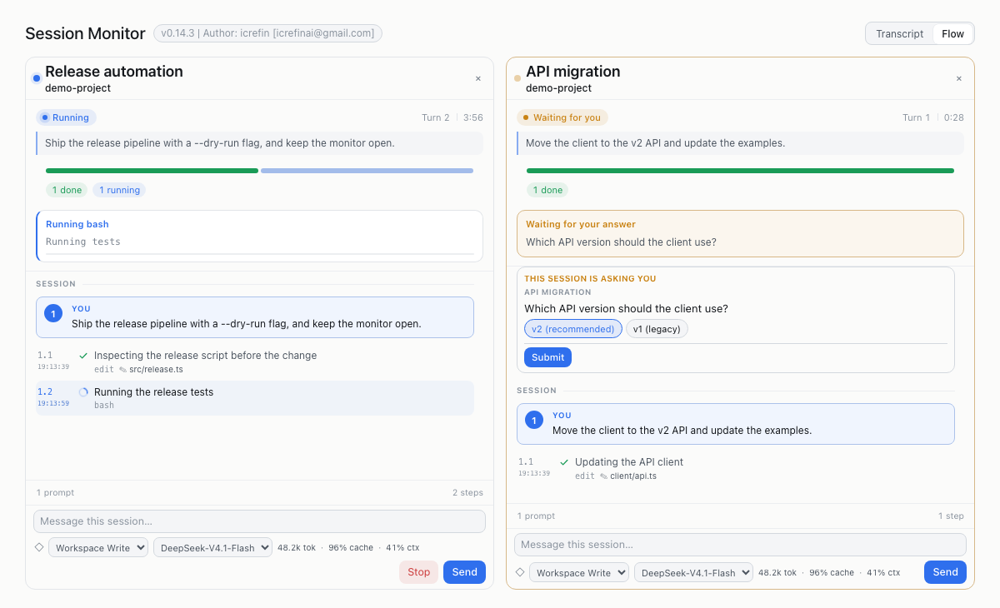

# dsh-session-monitor

**English** | [简体中文](README.zh-CN.md)

[](LICENSE)
[](https://github.com/icrefin/dsh-session-monitor/releases)
[](https://github.com/icrefin/dsh-session-monitor/actions/workflows/ci.yml)
[](https://github.com/icrefin/dsh-session-monitor/commits/main)
[](https://github.com/icrefin/dsh-session-monitor/stargazers)

A live grid of every DeepSeek Harness session — transcript or the whole-session flow, with its own composer.

DeepSeek Harness shows one conversation at a time. While several sessions work in
parallel, the sidebar tells you *that* a session is running or waiting — the
question itself, the turn it is in, and the message it wants to send stay behind
its own row. This plugin adds **Session Monitor** to the left sidebar, directly under
**Plugins**, and opens a grid with one card per active or recently used session:

```
┌ Session Monitor ─────────────────┬ Session Monitor ─────────────────┐
│ ● dsh-plugins · working · 2m     │ ● release notes · waiting · 4m   │
│   you  Add a --dry-run flag…     │   ┌ This session is asking you ┐  │
│   bash  command=pnpm test        │   │ Which branch should ship? │  │
│   …                              │   │ ( ) main  ( ) next        │  │
│   [Message this session…] [Send] │   └───────────────────────────┘  │
└──────────────────────────────────┴──────────────────────────────────┘
```

Each card carries, for a session you are **not** viewing either:

- **its live transcript** — your prompts, the assistant's streaming text, tool
  calls with their outcome, and approval/retry notices, updated as the session
  writes them; in **Flow** mode the transcript rows are replaced with the numbered
  flow view from `dsh-session-progress` (see [Two views](#two-views));
- **the pending question or approval**, answerable in the card;
- **a composer** that sends a prompt to that session; while the session runs it
  enters the next-turn inbox (no Queue/Steer toggle);
- **a Stop button** while the session runs, which stops the turn through the
  session's own `cancel()`;
- **a clickable title**: clicking a card's title opens that session in the
  conversation view (`ctx.uiWorkspace.openSession(id)`) **and unfolds the
  Workspace group that holds it in the sidebar**, so its row is visible there
  too instead of staying hidden behind a group you had folded; a composition
  without the navigation service keeps the title as a plain heading;
- **a completion reminder**: a session whose run ended unread draws a green dot
  and a `done` label; clicking anywhere on the card clears it back to the grey
  idle dot, and the next run lights it again;
- **its permission preset**, switchable from the card (Read Only, Workspace Write,
  Full access, and any other preset the Host offers) without opening the session;
- **the messages queued for its next turn**, each with the dock's own **Steer**
  (while the session runs), **Edit** and **Discard** actions;
- **its model**, switchable from the same row as the permission preset, using the
  session's shared model directory (the one the composer picker and `/model` use);
- **its usage readout** on that same row: tokens consumed, prompt-cache hit share
  and context-window occupancy, read from the same `tokenUsage` and
  `contextPressure` projections the native composer footer uses;
- a **remove** button that takes the session off this grid only.

The toolbar also **starts sessions**: a **New Session** button with a Workspace
drop-down beside it. Pick where the session belongs, click the button, and its
card appears **while the monitor stays open and no other card moves**: with room
it joins at the end, and on a full grid it takes the oldest card's slot. The drop-down's last row, **Choose a
folder…**, opens the host's folder chooser and adopts the picked directory as a
new Workspace first, so you can start a session in a folder the sidebar does not
list yet. The chosen Workspace is remembered in this browser.

## Screenshots



Flow mode replaces the transcript rows with the whole session: the status header, step rail,
activity card, numbered prompts and steps, and the card's own composer, selectors, usage and
pending answer block. The image is a component render with synthetic data, not a capture of a
real session.

## Two views

The toolbar carries a **Transcript | Flow** switch, and the choice is remembered in
this browser beside the card budget:

- **Transcript** is the original monitor: the live transcript, the pending question,
  the queue and the composer.
- **Flow** replaces only a card's transcript rows with the exact view the **Session
  Progress** plugin (`dsh-session-progress`) draws in the right Sidebar. The card
  keeps its own head — title, Workspace, remove — and its own actions: the pending
  answer block, the queue, the composer with permission and model selectors, the
  usage readout, Stop and Send. The flow fills the space between them:

  - a status pill (*Running*, *Waiting for you*, *Turn complete*, *Turn failed*,
    *Idle*), the turn number and the elapsed clock;
  - the current prompt, clipped to two lines, and a rail with one segment per
    step of the current turn;
  - the activity card: the tool in flight, the thinking text still arriving, the
    approval or question the session waits on, or the turn's ending;
  - the whole session as a numbered list, from its first prompt: every prompt is
    a tinted `You` block (`1`, `2`, `3`…), every agent step is numbered under it
    (`1.1`, `1.2`, `2.1`…) with its status mark and local start time;
  - a footer with the session's prompt and step totals.

  A pending question keeps its answer block at the top of the flow body, so the
  controls share the list's scroll region and a long question cannot push the
  flow header out of a short card. The flow list follows the tail unless a pending
  request holds it at the top.

  The view uses the same theme tokens and the same `dsh-session-progress`
  layout and copy, ported into this bundle under its own `dsf-` class prefix, so
  enabling both plugins cannot make the two stylesheets collide. Only the
  progress panel's model-written command descriptions are absent: this plugin
  keeps its host half empty, so a shell step shows the panel's own local purpose
  phrase (*Running tests*) and never the command text. The title is that purpose alone, with its first letter capitalized; the row meta line already names the tool.

Flow needs the session from its first prompt, so in that mode a card asks its
retained binding for the older history pages (`binding.session.loadOlder()`)
until the start is loaded. The transcript mode keeps its readable tail window;
the retained stream is the same one in both modes.

The flow panel is a tall surface: its header alone is most of a 220 px grid cell.
Flow mode therefore gives every card a **480 px minimum height** and scrolls the
grid when the cards no longer fit, instead of squeezing the view into a strip.
Transcript mode keeps the original contract — every card on one page.

## The grid

- **Which sessions.** Every non-blank root session in the client catalog.
  Subagent child rows and the provisional New Session row are not conversations
  a person monitors here — except the blank session this toolbar just created,
  whose card is exactly what the user asked for until its first turn titles it.
- **The order freezes once cards are on screen.** The grid seeds its order one
  time (waiting, then running, then recency) and then stores it in `localStorage`.
  After that, a prompt, a new turn or a state change updates a card's content but
  never its position — a session that becomes the most recently active does not
  jump to the front, and leaving the panel or restarting the app resumes the same
  cells instead of re-seeding them. A card keeps its position until it is the
  **oldest** card and a new session needs that slot: the newcomer takes that exact
  cell and the displaced card waits at the order's tail. A session that appears
  later joins at the end while there is room. A waiting card is never displaced. A
  session created by this toolbar follows the same rule, so starting one never
  reshuffles the page.
- **Activity never reorders the grid.** A prompt, a new turn or a state change
  updates a card's content, never its position. The one deliberate exception is
  a smaller card budget: lowering it re-seeds the grid, so the cards that stay
  on screen are the **newest** sessions, arranged newest-first. Raising the
  budget keeps that order and reveals the rest in place.
- **Card budget.** The toolbar's **Cards** stepper moves the budget one card at
  a time, from **2** up to **24** (default 9), for idle and running sessions. The
  number in the middle is editable, and a value typed outside the range is
  normalised when the field is left. A session **waiting for the user is never cut
  off by the budget** — it is the reason the panel exists.
- **Cards per row.** The toolbar's **Per row** control sets an exact count (2–6)
  or leaves the grid on **Auto**, which fills the column with 260px cards. The
  choice is remembered beside the removed ids.
- **View mode.** The toolbar's **Transcript | Flow** switch sets how every card
  presents its session. It is a reading preference, stored with the other
  preferences and restored on the next visit; it never changes which sessions
  are shown or where their cards sit.
- **Removal.** Removed ids are stored in this browser's `localStorage`
  (`dsh-session-monitor:prefs`). A removed session keeps running, keeps its
  history and stays in the sidebar; only this grid forgets it. The toolbar's
  **Restore removed** button brings every one of them back.
- **Starting a session.** The toolbar's **New Session** button calls
  `ctx.sessions.create({ workspaceId })` and keeps the monitor open: the Host
  returns the new session id, the page records it as a *spawned blank*, and the
  next reconcile places its card — at the end while there is room, or in the
  oldest card's slot on a full grid. The card is titled "New Session" and carries
  the normal composer, so the first prompt is typed there. The drop-down defaults to the Workspace of the most recently used
  session, and the Workspace you last chose is remembered in `localStorage`
  beside the removed ids. **Choose a folder…** is a row of that same drop-down: it
  calls the host's folder chooser, adopts the directory as a Workspace
  (`ctx.workspaces.create({ path })`) and creates the session there. A cancelled
  chooser changes nothing, and a refused start is reported in the toolbar with the
  host's own message. A composition with no session-creation verb renders no
  new-session control at all, and the folder row is absent when no folder chooser
  is composed.
- **One card, one stream.** A card holds a Session reference
  (`ctx.sessions.retain()`) while it is mounted and releases it on unmount, so the
  grid opens exactly as many history streams as it shows cards, and leaving the
  panel closes all of them.

## How it reads and acts

The plugin is browser-only in behaviour. It registers one sidebar row, one `main`
panel, and two locale dictionaries — no host route, no tool, no event listener —
because every fact it needs already exists in the client:

| Fact | Source |
|---|---|
| session identity, title, workspace path, recency, run-state fallback | `ctx.sessions.list` |
| Workspace title shown on the card | `ctx.workspaces.list` |
| pending question / approval | `ctx.uiSession.sessionStatus` |
| live run state of one card | `binding.session.getSnapshot().running` |
| live transcript, and the flow view's event log | `ctx.sessions.retain()` → `binding.eventSource` |
| older history pages for the flow view | `binding.session.loadOlder()` |
| send a prompt | `binding.session.prompt(content, 'queue')` |
| answer a pending request | the carrier's own `answer()` |
| current permission preset | `binding.session.projections.faceOf('permissions')` |
| selectable permission presets | `ctx.remote.permissionPresets.catalog()` |
| switch the preset | `binding.session.command('/permission <preset>')` |
| queued messages | `binding.session.projections.faceOf('inbox')` → `next-turn` |
| steer / edit / discard a queued message | `binding.session.updateQueue(id, { kind: 'steer' \| 'edit' \| 'remove' })` |
| stop the running turn | `binding.session.cancel()` |
| open the session | `ctx.uiWorkspace.openSession(sessionId)` |
| current model and catalog | `ctx.modelDirectories.directoryFor(sessionId)` |
| switch the model | the same directory's `select({ provider, model })` |
| create a session in place | `ctx.sessions.create({ workspaceId })` (fallback `ctx.uiWorkspace.connectWorkspace`) |
| keep a created blank session as a card | the monitor's local `spawned` set in `localStorage` |
| adopt a folder as a Workspace | `ctx.workspaces.create({ path })` |
| ask for a folder | `ctx.remote.directoryPicker.pick()` |

**Why answering works from another session's card.** The shipped approval and
question panels publish their request into the unified pending-interaction
projection, and both carriers (`PendingApproval`, `PendingQuestion`) expose the
same `answer()` their own composer panel calls — approvals take
`'allowed-once' | 'rejected'`, questions take `{ answers: [{ id, selected, custom }] }`.
The monitor drives that method; it does not reimplement the answer path. A
carrier that offers no `answer()` renders nothing, and a refused answer is shown
as a failure on the card.

**Why the permission control can switch another session.** It reads the current
preset from that session's own `permissions` projection, offers the presets the
Host's process catalog lists, and submits the same `/permission <preset>` line
the shipped composer picker submits — the Host performs the switch, and the
projection reporting the new value is the card's settlement. Full access
switches with no extra step: choosing it in this picker is the explicit
selection. Auto review keeps one inline acknowledgement because it changes how
every request is reviewed. The namespace is optional — it is not in this bundle's
required `inject` list and is resolved reflectively through
`ctx.get('remote.permissionPresets')` — so a composition without permission
presets publishes no catalog, keeps the whole panel mounted, and the cards
render no control at all.

**Why the queue and the model are the session's own too.** The card lists the
`next-turn` rows of the session's `inbox` projection — the same rows the
main-view queue dock renders — and its three buttons call the dock's exact
actions: **Steer** (`{ kind: 'steer' }`, only while the session runs), **Edit**
(an inline editor saving `{ kind: 'edit', content: [{ type: 'text', text }] }`)
and **Discard** (`{ kind: 'remove' }`). The same convergence applies for a turn
that ended first or a row the agent already claimed. The composer has no
Queue/Steer toggle: a send is always `queue`, steering is a queue-row action,
and the composer's **Stop** button (shown only while the session runs) calls
`session.cancel()` — the main-view Stop action.
The model control resolves the shared per-session directory through
`ctx.modelDirectories` (waited for in an optional child scope that also injects
`remote.session`, because that service reaches the namespace through the
caller's context), so a model switched on a card is what the composer and
`/model` see next. A model with advertised reasoning efforts is switched at its
default effort; the card has no effort row of its own.

**Why the new session does not open the conversation.** The point of the monitor is
to keep several sessions in view; a click that navigates away defeats it. The
toolbar therefore calls `ctx.sessions.create({ workspaceId })` and keeps the id the
Host returns. Because a brand-new session is *blank*, the grid would normally
filter it out, so the id is recorded in this browser's `spawned` set and
`collectSessions` keeps the blank row as a card (titled "New Session") until its
first turn gives it a real title. The card then enters the frozen order like any
other new arrival, which is what keeps the rest of the grid still. A displaced
card stays known at the order's tail rather than being dropped; otherwise it would
look like a new arrival on the next reconcile and evict another card, and the grid
would churn. A composition without `sessions.create` falls back to
`ctx.uiWorkspace.connectWorkspace(workspaceId)`, which also creates without
navigating (it may reuse a blank session). Both services are optional and read
reflectively (`ctx.get(...)`), so the panel still mounts — and simply renders no
new-session control — where neither exists.

**One known boundary.** A question routed to a different browser tab (or one
whose foreground claim ended) refuses an answer made here
(`no channel accepts an answer yet`); the card says so rather than pretending the
answer was accepted.

## Design decisions worth stating

- **The order is frozen after the first paint — except when the card budget
  drops.** The same precedence the shipped Session rows use (pending → ongoing →
  finished → idle) only seeds the grid; once a card is displayed, activity must
  not move it — and the order is stored, so a remount or an app restart does not
  re-seed it either. That is what keeps a card you are watching where you left it
  when you send it a prompt, and it makes a new session take the least recently
  used card's slot instead of pushing everything down. Lowering the **card
  budget** is the deliberate exception: it re-seeds the grid, so the cards that
  stay on screen are the newest sessions, arranged newest-first. Raising the
  budget keeps that order and reveals the rest in place.
- **The Workspace title is the card's second line, in normal text colour.** It comes from the Workspace registry,
  not from the `cwd` string, so a renamed Workspace shows its name; the raw path stays a tooltip. State and time
  follow it in the muted caption colour, and the status dot repeats the state at a glance.
- **The card head is one step above the transcript, and its two lines are proportional.** The session title is
  `--dsh-content-font-size` plus 4 px (18 px at the default 14 px), and the Workspace / state / time line under it
  is exactly **1.5x smaller** than that title (12 px), set once on the card as `--dsm-card-title-size` and
  `--dsm-card-sub-size`. Both come from the same token, so the Settings → General font-size preference scales the
  whole head together instead of leaving the second line pinned to a size of its own.
- **Transcript text is the conversation's text size.** User and assistant rows read `--dsh-content-font-size`
  (14 px by default) with the same line-height delta the Chat uses, and tool/notice rows read
  `--dsh-content-font-size-secondary`; the card therefore follows the Settings → General font-size preference
  instead of carrying a size of its own.
- **The time is activity, not just the last prompt.** Each card's "ago" label follows the newest visible event
  (falling back to the catalog's recency), so it moves while the session writes and freezes exactly when the card
  falls behind — a built-in liveness check.
- **The transcript is compact on purpose.** It shows user text, assistant text, one
  line per tool call with its first argument, an error dot for failures, and
  approval/retry notices; tool lines are summaries by design, while user and
  assistant messages are shown in full. History older than the row window stays in
  the conversation view.
- **The transcript window is 60 rows, and message text inside a row is kept whole.**
  A card scrolls, so a long answer stays readable to its last word; only the number
  of rows is bounded, never the text of one row. Full history beyond the window stays
  in the conversation view.
- **Removal is local by design.** "Remove from monitor" is a statement about this
  panel, not about the session, so it must not touch the host log or the sidebar.
- **Transcript mode is one fixed page; Flow mode is a scrollable grid.** Transcript mode takes the whole centre
  column and the whole height below its header; the column count and row count are solved from that box, so every
  card is on screen at once with no page scrollbar. Flow mode keeps the card's composer and actions, so each card
  gets a **480 px minimum height** and the grid scrolls when the cards no longer fit. **Auto** picks the column
  count whose cells stay closest to the nominal card size; an explicit **Per row** count is honoured. A card body
  scrolls only inside its own cell: the transcript hides its scrollbar and follows its tail; the flow body uses the
  progress panel's styled scrollbar. A pending question uses that same scroll region, with its answer row pinned to
  the card's bottom; narrow cards drop the time, the state word, then the queue action buttons so the Workspace
  name and the answer controls survive.
- **A card's status comes from that card's own session.** `binding.session.getSnapshot().running` is the
  authoritative per-session run bit: the Host's status event calls `Session.handleRunning()`. The catalog row is
  only the fallback, so a lagging shared snapshot can never hide live work. Each card reconciles its two snapshots
  every 2 s, and the page asks the Host for a fresh catalog baseline on mount and every 15 s — a missed push costs
  one interval, not a wrong mark.
- **The panel cannot blank the centre column.** The harness isolates a slot entry with a boundary that
  **retires** it: one throw during render leaves an empty region until the page is reloaded. The monitor
  therefore renders behind its own boundary (`Boundaries.tsx`), so a failure stays inside the plugin and shows a
  readable *Try again* panel that remounts the page; each card has a second boundary, so one unreadable session
  costs its own cell, not the rest of the grid.
- **Host copy reaches React as text, never as an object.** An approval publishes `displayReason` as a locale map
  (`{ en, zh, … }`), not a ready string — every sandbox-escalation request carries one. The map is resolved through
  the active language (`ctx.locale.resolveText`), with the English entry as the fallback. A map rendered as a child
  throws "Objects are not valid as a React child" and takes the panel with it; that was the blank-page failure in
  0.11.3 and earlier.
- **Nested Cordis services are read reflectively, never through the proxy.** `sessionStatus` is not a
  member of `uiSession`: it is a service registered as `uiSession.sessionStatus`, and the context proxy
  throws `cannot get property "uiSession.sessionStatus" without inject` for a plugin that did not declare
  that exact dotted name. The read used to happen while the page rendered, so every mount of the monitor
  ended in *This page could not be drawn*. It is now resolved with the reflective `ctx.get()` at mount
  time (like `remote.permissionPresets`), so a composition without the projection still mounts the panel.
- **One reference source.** All retention is accounted under the source key
  `sessionMonitor`, so `sessions.retainInfo(id)` distinguishes the monitor's
  streams from the conversation's own.

## Verified

- `pnpm check` — typecheck of both halves and the tests, the built bundle, then
  the test run: **236 tests**, including a jsdom mount of the real page against
  fake projections (ordering, live window, question answer, prompt send, removal,
  open failure, a long answer rendered whole, the new-session control's default
  Workspace, its start call, folder adoption, a cancelled chooser and a refused
  start), a created blank session taking the oldest card's slot on the page
  without navigating, a card keeping its cell across a panel remount and a reload,
  a smaller card budget re-seeding the grid to the newest sessions, the toolbar's
  card-budget stepper moving one card at a time and stopping at 2 and 24, a
  `pending` catalog leaving the stored order alone, a stylesheet guard
  (every rendered class has a rule; no literal colours), and an execution of the
  **built** bundle behind a fake module loader (bundle id, exports, real `apply`
  wiring, no second React).
- **Robustness** (`test/robustness.spec.tsx`): an approval whose `displayReason`
  is a locale map renders the resolved sentence — with `ctx.locale.resolveText`
  and, without it, the map's English entry — and the panel stays mounted; a plain
  string and a malformed map both render; a throwing card keeps its neighbours;
  a throwing page renders the *Try again* panel and remounts on click; a page whose
  pref store throws is contained inside the plugin. A table of malformed
  projections (non-array catalog `ids`, a `null` catalog row, a `null` status row,
  junk event-window entries, a `null` permission option, junk model groups, a
  `null` queued row) all render the page instead of blanking it.
- **Foreign data at the page level** (`test/foreign-data.spec.tsx`): a matrix of
  single-field mutations — every catalog, status, Workspace and preference value
  the page reads, each replaced by `null`, a number, a string, an array, a
  locale map and a function — mounts the real panel with the toolbar included
  and asserts the page-level fallback never appears. The paths this closed: a
  snapshot whose `byId` is `null`, a row with no usable title whose `cwd` is not
  a string (the title fallback called `.split()`), and a `null` row for an id the
  page spawned (the prune effect read `.blank`). The fallback also prints the
  one-line reason it caught, so a recurrence is readable in place.
- **The panel in a real browser** (2026-11-23, 0.14.3, headless Chrome over CDP against a private
  `DSH_HOME` with three real session logs): the sidebar opens the monitor; the toolbar reads
  **Transcript | Flow**; Flow draws three progress panels (260, 223 and 367 steps), keeps all three
  composers (the prompt input, permission and model selectors, usage and Send), keeps 480 px cards
  with a scrolling grid, and returns to the transcript when switched back. The same composition was checked in the light and dark themes at 1440×900 and at 1000×700
  (two columns, 480 px cards, no page overflow), and a fresh tab reported no console errors. The
  0.11.5 failure (`cannot get property "uiSession.sessionStatus" without inject`) was reproduced in
  an earlier run and remains covered by `test/session-status.spec.ts`.
- Not verified: the operator's main profile was not reloaded during this work (a page reload or an
  app restart loads the client half), the Electron window itself, and the waiting-card answer flow on
  real streams — the waiting flow state was rendered from a static component fixture, not observed on
  a live blocked session.

## Install

```sh
cd dsh-session-monitor
pnpm install
pnpm check
scripts/install.sh            # builds, packs and prints the tarball path
```

Install that tarball through **Settings → Plugins** (or
`dsh plugin --profile <name> add <tarball>` for a CLI-managed profile), then
restart the application. The desktop profile is owned by the Electron app, so its
supported install path is the Plugins page; a bundle added to a running profile is
imported at the next start.

## Layout

```
src/index.ts                     host half: identity only, registers nothing
src/client/index.tsx             sidebar row + main page registration
src/client/Boundaries.tsx        page- and card-level crash containment
src/client/MonitorPanel.tsx      registered entry: the bounded page
src/client/MonitorPage.tsx       grid, toolbar, card selection
src/client/CardBudgetControl.tsx card-budget stepper (− / number / +)
src/client/NewSessionControl.tsx new-session button + Workspace drop-down
src/client/SessionCard.tsx       one card: header, transcript or flow, pending, composer
src/client/FlowView.tsx          the session-progress view, embedded in a card
src/client/flowProgress.ts       the session-wide flow derivation (pure)
src/client/flowTitles.ts         step titles and the activity detail
src/client/flowBashPurpose.ts    the local phrase for a shell command
src/client/FlowIcons.tsx         step and empty-state glyphs
src/client/InteractionCard.tsx   question/approval answer block
src/client/model.ts              which sessions, what happened, localized text (pure)
src/client/store.ts              removed ids, budget, view mode (localStorage)
src/client/useSessionFeed.ts     retain/follow/release one session
src/client/styles.ts             theme-token stylesheet
test/                            model, flow, store, manifest, page (jsdom), robustness, built bundle
```

## License

MIT.

---

Contributions are welcome — see [CONTRIBUTING.md](.github/CONTRIBUTING.md). Report security issues through [SECURITY.md](.github/SECURITY.md).

If this grid saves you a trip through browser tabs, a ⭐ helps other DSH users find it.
