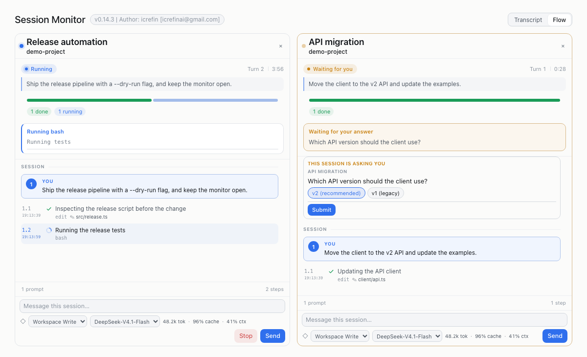

# dsh-session-monitor

[English](README.md) | **简体中文**

[](LICENSE)
[](https://github.com/icrefin/dsh-session-monitor/releases)
[](https://github.com/icrefin/dsh-session-monitor/actions/workflows/ci.yml)
[](https://github.com/icrefin/dsh-session-monitor/commits/main)
[](https://github.com/icrefin/dsh-session-monitor/stargazers)

覆盖每个 DeepSeek Harness 会话的实时网格：实时记录或整段会话流程，每张卡片都有自己的输入框。

DeepSeek Harness 一次只显示一个会话。多个会话并行工作时，侧栏只告诉你某个会话
*正在运行*或*正在等待*，而它到底在问什么、进行到第几轮、想发什么消息，都藏在它自己
那一行后面。这个插件在左侧栏加入 **会话监视器**（Session Monitor），位置紧挨在
**插件**下面（`order: 5`），打开后是每个活跃或最近使用会话各一张卡片的网格：

```
┌ 会话监视器 ──────────────────────┬ 会话监视器 ──────────────────────┐
│ ● dsh-plugins · 运行中 · 2 分钟  │ ● 发布说明 · 等待你回答 · 4 分钟 │
│   你 加一个 --dry-run 参数…      │   ┌ 这个会话正在向你提问 ┐        │
│   bash  command=pnpm test        │   │ 发布到哪个分支？      │        │
│   …                              │   │ ( ) main  ( ) next    │        │
│   [给这个会话发消息…] [发送]     │   └───────────────────────┘        │
└──────────────────────────────────┴──────────────────────────────────┘
```

对于你**没有正在查看**的会话，每张卡片提供：

- **实时记录**：你的提示、助手流式输出、工具调用及结果、审批/重试提示，都随会话
  写入而更新；切到 **流程** 视图后，卡片里的实时记录换成 `dsh-session-progress` 的整段
  会话流程视图（见下一节）；
- **待回答的问题或审批**，可直接在卡片里回答；
- **输入框**：向该会话发消息；会话运行中时进入下一轮队列（没有 Queue/Steer 切换）；
- **停止按钮**：会话运行时出现，通过该会话自己的 `cancel()` 停止当前回合；
- **可点击标题**：打开该会话的对话视图，同时**展开它在侧栏里所在的工作区分组**；
- **完成提醒**：会话结束而你没看过时显示绿点与 `已完成`；点击卡片任意位置清除，
  下一次运行再亮起；
- **权限预设**：Read Only / Workspace Write / Full access 以及宿主提供的其他预设，
  不打开会话就能切换；
- **排队消息**：列出下一条消息，并提供与主视图队列相同的 **插话**、**编辑**、
  **丢弃** 操作；
- **模型**：从会话共享的模型目录切换，和输入框选择器、`/model` 使用同一来源；
- **用量读数**：token 消耗、提示缓存命中率和上下文占用，来自原生输入框页脚读取的
  同一组 `tokenUsage` / `contextPressure` 投影；
- **移除按钮**：只把该会话从本网格移除。

工具栏还能**创建会话**：**新会话** 按钮旁边的 **工作区** 下拉框选择位置，点击后卡片
出现而**监视器保持打开，其他卡片不动**；有空间时排在末尾，满格时占用最旧卡片的位置。
下拉框最后一行的 **选择文件夹…** 会打开宿主的文件夹选择器，先把它添加为工作区再创建
会话。上次选择的工作区会在此浏览器中记住。

## 截图



流程模式用整段会话替换实时记录：状态页头、步骤轨道、活动卡片、编号的提示与步骤，以及卡片自己的输入框、选择器、用量和待回答块。图片是使用合成数据的组件渲染，不是真实会话的截图。

## 两种视图

工具栏有 **记录 | 流程** 切换，选择与其他偏好一起保存在浏览器里：

- **记录** 是原有监视器：实时记录、待回答问题、队列与输入框。
- **流程** 只把卡片里的实时记录换成 **会话进度** 插件（`dsh-session-progress`）在
  右侧栏绘制的同一套视图。卡片保留自己的头部（标题、工作区、移除按钮）和自己的操作：
  待回答块、队列、带权限与模型选择器的输入框、用量读数、停止与发送。流程占据这些区域
  之间的高度：
  - 状态胶囊（*运行中*、*等待你处理*、*回合完成*、*回合失败*、*空闲*）、回合编号与
    已用时间；
  - 当前提示（最多两行）与本回合的步骤轨道；
  - 活动卡片：正在运行的工具、仍在到达的思考文本、等待中的审批或问题，或回合结束；
  - 整个会话的编号列表：每条提示是带 `你` 标签的着色块（`1`、`2`、`3`…），每个
    agent 步骤编号在它下面（`1.1`、`1.2`、`2.1`…），带状态图标与本地开始时间；
  - 页脚显示提示数与步骤总数。

  待回答的问题块位于流程正文顶部，与列表共用滚动区域，因此长问题不会把流程页头挤出
  卡片；有等待请求时列表停在顶部，否则跟随最新一行。

  这些样式和文案来自 `dsh-session-progress`，移植进本插件时保留其版式，并把类名前缀
  改为 `dsf-`，因此两个插件同时启用也不会互相覆盖样式。唯一的差别是：本插件保持宿主
  半端为空，不请求进度面板用来描述 shell 命令的模型短语，所以 shell 步骤显示进度面板
  自己的本地短语（例如 *运行测试*），并把首字母大写后直接作为标题（行内已显示工具名）；仍然绝不打印命令文本。

流程视图需要从第一条提示开始读取会话，因此该模式下卡片会让已保留的绑定继续加载更早
的历史页（`binding.session.loadOlder()`），直到起点载入完成；记录模式仍只读尾部窗口。
两种模式使用的是同一条已保留的事件流。流程面板本身很高（页头就接近 220px 网格单元的
大部分），因此流程模式给每张卡片一个 **480px 最小高度**，卡片放不下时滚动网格，而不是
把视图压成一条。记录模式仍保持“每张卡片都在一页内”的原约定。

## 网格

- **哪些会话**：客户端目录中所有非空的根会话。子代理行和临时的“新会话”行不是要监视的
  对话，只有本工具栏刚创建、还没有第一轮的空会话例外。
- **顺序冻结**：网格只在第一次按 等待 > 运行 > 最近活跃 排一次序，随后写入
  `localStorage`。此后提示、新回合或状态变化只更新卡片内容，不改变位置；离开面板或
  重启应用会恢复原来的格子。卡片一直保留位置，直到它成为最旧的一张并且有新的会话需要
  这个格子；新来的会话在有空间时排在末尾。
- **卡片数量**：工具栏的 **卡片** 步进器一次增减一张，范围 **2–24**（默认 9），只约束
  空闲和运行中的会话；**等待你的会话永远不会被预算裁掉**。
- **每行数量**：**每行** 可选择 2–6 张，或 **自动**，按 260px 卡片填充。
- **视图模式**：**记录 | 流程** 决定每张卡片如何呈现会话。它是阅读偏好，会随其他偏好
  保存并在下次恢复；不改变显示哪些会话，也不改变卡片位置。
- **移除**：移除的 id 保存在 `localStorage`（键 `dsh-session-monitor:prefs`）。被移除的
  会话继续运行、保留历史、留在侧栏；只是这个网格忘记它。工具栏的 **恢复已移除** 按钮
  把它们全部带回来。
- **一个卡片一条流**：卡片挂载时持有一个 `ctx.sessions.retain()` 引用，卸载时释放，
  因此网格打开的流数量等于卡片数量，离开面板即全部关闭。

## 数据来源与操作方式

插件在行为上只在浏览器端工作：注册一个侧栏行、一个 `main` 面板和两套语言字典，没有
宿主路由、没有工具、没有事件监听。所有事实都来自客户端已有的投影：

| 事实 | 来源 |
|---|---|
| 会话身份、标题、工作区路径、最近活跃、运行状态回退 | `ctx.sessions.list` |
| 卡片上的工作区标题 | `ctx.workspaces.list` |
| 待回答问题 / 审批 | `ctx.uiSession.sessionStatus` |
| 单张卡片的实时运行状态 | `binding.session.getSnapshot().running` |
| 实时记录与流程视图的事件日志 | `ctx.sessions.retain()` → `binding.eventSource` |
| 流程视图需要的更早历史页 | `binding.session.loadOlder()` |
| 发送提示 | `binding.session.prompt(content, 'queue')` |
| 回答待处理请求 | 请求载体自己的 `answer()` |
| 当前权限预设 | `binding.session.projections.faceOf('permissions')` |
| 可切换的权限预设 | `ctx.remote.permissionPresets.catalog()` |
| 切换权限 | `binding.session.command('/permission <preset>')` |
| 排队消息 | `binding.session.projections.faceOf('inbox')` → `next-turn` |
| 插话 / 编辑 / 丢弃排队消息 | `binding.session.updateQueue(id, { kind })` |
| 停止运行中的回合 | `binding.session.cancel()` |
| 打开会话 | `ctx.uiWorkspace.openSession(sessionId)` |
| 当前模型与模型目录 | `ctx.modelDirectories.directoryFor(sessionId)` |
| 切换模型 | 同一目录的 `select({ provider, model })` |
| 原地创建会话 | `ctx.sessions.create({ workspaceId })`（回退 `uiWorkspace.connectWorkspace`） |
| 把文件夹添加为工作区 | `ctx.workspaces.create({ path })` |
| 请求选择文件夹 | `ctx.remote.directoryPicker.pick()` |

**为什么能从另一张卡片回答问题**：审批与问题面板把请求发布到统一的待处理交互投影，
两个载体（`PendingApproval`、`PendingQuestion`）都暴露各自的 `answer()`；监视器直接
驱动它，不重新实现回答路径。

**为什么能切换另一个会话的权限**：卡片从该会话自己的 `permissions` 投影读取当前值，
列出宿主进程目录提供的预设，并提交与原生选择器相同的 `/permission <preset>` 命令。

**为什么能切换模型**：卡片读取该会话共享的模型目录（输入框选择器和 `/model` 的同一
实例），调用它的 `select({ provider, model })`。

## 值得说明的设计取舍

- **首次绘制之后顺序就冻结。** 内置 Session 行用的同一套优先级（待处理 → 进行中 →
  已完成 → 闲置）只用来决定网格的初始顺序；卡片一旦显示，活动就不许移动它——顺序还被存了
  下来，所以重挂载或重启应用也不会重新排一遍。这正是你给某个会话发提示词时，正在看的那张
  卡片留在原地的原因；也正因为如此，新会话会接替最久未使用那张卡的位置，而不是把别的卡片
  全往下挤。调小 **卡片预算** 是有意为之的例外：它会把网格重新排一遍，留下来的卡片是最新
  的会话，并按由新到旧排列；调大预算则保持这个顺序，把其余的卡片显出来。
- **工作区标题是卡片的第二行，用正文颜色。** 它来自工作区注册表，而不是 `cwd` 字符串，
  所以重命名过的工作区会显示它的名字；原始路径仍作为悬停提示保留。状态和时间紧随其后，
  用弱化的说明文字颜色，状态圆点让人一眼看出状态。
- **卡片头部比对话正文大一级，两行之间成比例。** 会话标题是 `--dsh-content-font-size`
  再加 4 px（默认 14 px 时为 18 px），它下面那行工作区 / 状态 / 时间正好**比标题小 1.5 倍**
  （12 px），只在卡片上定义一次：`--dsm-card-title-size` 与 `--dsm-card-sub-size`。两者出自
  同一个 token，所以 Settings → General 的字号偏好会把整个头部一起放大，而不会让第二行
  继续固定在自己的字号上。
- **对话文本用的是对话本身的字号。** 用户行和助手行读取 `--dsh-content-font-size`
  （默认 14 px），行高增量与 Chat 相同，工具/通知行读取
  `--dsh-content-font-size-secondary`；于是卡片跟随 Settings → General 里的字号偏好，
  而不是自带一套字号。
- **时间反映的是活动，而不只是最后一次提示词。** 每张卡片的“多久之前”标签跟随最新的
  可见事件（回退到目录的最近使用时间），所以会话写入时它在走，而卡片落在后面时它恰好
  停住——一处内置的活性检查。
- **对话记录刻意紧凑。** 它显示用户文本、助手文本、每次工具调用一行并带第一个参数、
  失败时的错误圆点，以及批准/重试通知；工具行按设计就是摘要，而用户和助手消息完整显示。
  窗口之外的历史留在对话视图里。
- **对话记录窗口是 60 行，而一行内的消息文本保持完整。** 卡片可滚动，所以一个长回答能读到
  最后一个字；只有行数有上限，单行文本永远不截断。窗口之外的全部历史留在对话视图里。
- **移除是刻意的本地行为。**“从监控中移除”说的是这个面板，不是这个会话，所以它不能碰
  宿主日志，也不能碰侧边栏。
- **记录模式是一整页固定的页面；流程模式是滚动的网格。** 记录模式占据整个中间列，以及它
  头部之下的整个高度；列数与行数由这个盒子算出，所以每张卡片同时可见，没有页面滚动条。
  流程模式保留卡片的输入框与操作，因此每张卡片至少 **480px** 高，放不下时滚动网格。
  **Auto** 选出最接近标称卡片尺寸的那一列数；显式的 **Per row** 数量会被采纳。卡片只在
  自己的格子里滚动：记录模式隐藏滚动条并跟随尾部；流程模式的进度正文使用进度面板自己的
  细滚动条。待回答的问题使用同一块滚动区域（流程模式中位于流程正文顶部），回答行固定在
  卡片底部；卡片变窄时，依次舍弃时间、状态词、队列操作按钮，好让工作区名和回答控件得以保留。
- **卡片的状态来自它自己的那个会话。** `binding.session.getSnapshot().running` 是权威的
  按会话运行位：宿主的状态事件会调用 `Session.handleRunning()`。目录行只是回退，所以一份
  滞后的共享快照永远无法掩盖正在发生的工作。每张卡片每 2 s 核对它的两份快照，页面在挂载
  时以及每 15 s 向宿主索取一份新的目录基线——漏掉一次推送的代价是一个间隔，而不是一个
  错误的标记。
- **面板不会让中间列变空。** 宿主用一道边界隔离 slot 条目，而这道边界会把它**退役**：
  渲染时抛一次异常，中间区域就一直空着，直到页面重新加载。所以监控面板渲染在自己的边界
  之后（`Boundaries.tsx`），失败留在插件内部，显示一块可读的 *Try again* 面板并重新挂载
  页面；每张卡片还有第二道边界，一个读不动的会话只损失自己那一格，不影响网格其余部分。
- **宿主文案以文本进入 React，绝不作为对象。** 批准请求把 `displayReason` 发布成语言映射
  （`{ en, zh, … }`），而不是现成的字符串——每个沙箱提权请求都带着一个。映射按当前语言
  （`ctx.locale.resolveText`）解析，英文条目作回退。把映射当子节点渲染会抛
  “Objects are not valid as a React child”，并把整个面板一起带走；那就是 0.11.3 及更早
  版本的空页面故障。
- **嵌套的 Cordis 服务用反射读取，绝不走代理。** `sessionStatus` 不是 `uiSession` 的成员：
  它注册为 `uiSession.sessionStatus`，而上下文代理对没有声明这个精确点号名的插件会抛
  `cannot get property "uiSession.sessionStatus" without inject`。这次读取原本发生在页面
  渲染期间，所以监控面板每次挂载都停在 *This page could not be drawn*。现在它在挂载时用
  反射的 `ctx.get()` 解析（与 `remote.permissionPresets` 一样），所以没有这个投影的组合
  也能挂载面板。
- **引用来源只有一个。** 所有 retain 都记在 `sessionMonitor` 这个 source key 下，因此
  `sessions.retainInfo(id)` 能把监控面板的流与对话自己的流区分开。

## 已验证

- `pnpm check`：宿主半端与客户端半端的类型检查、构建、**236 个测试**全部通过。测试
  包括真实页面的 jsdom 挂载（排序、实时窗口、回答问题、发送提示、移除、打开失败、
  长回答完整渲染、新会话控件的默认工作区、创建、选择文件夹、取消与拒绝）、**记录 → 流程
  → 记录** 的切换（编号流程、偏好持久化、更早历史页加载、输入框保留）、流程推导的
  26 个用例（提示分组、步骤编号、隐藏步骤与文件、等待活动、回合错误、时间格式），以及标题规则（目的即标题、首字母大写、绝不显示命令）、
  样式守卫（每个渲染的类都有规则、不使用字面颜色），以及用假模块加载器执行**构建产物**
  （包 id、导出、真实 `apply` 接线、不引入第二份 React）。
- **健壮性**：审批的 `displayReason` 是语言映射时能解析成字符串；卡片抛错不连累相邻
  卡片；页面抛错显示“重试”面板并可重新挂载；一张卡片只影响自己。
- **页面级外部数据**：目录、状态、工作区与偏好字段被逐个替换成 `null`、数字、字符串、
  数组、语言映射或函数时，页面仍能挂载。
- **流程视图组件**：`test/flow-view.spec.tsx` 把视图渲染成静态标记，检查页头、编号
  列表、等待活动与页脚，并可写出独立的预览页（`FLOW_PREVIEW_OUT=<路径>`）。
- **真实页面（0.14.3，隔离配置）**：使用独立的 `DSH_HOME` 和三个真实会话日志启动
  dsh web，用 headless Chrome 通过 CDP 检查：工具栏显示 **记录 | 流程**；流程模式绘制三块
  进度面板（260、223、367 步），三个输入框、权限/模型选择器、用量与发送按钮都保留，卡片
  保持 480px 并滚动；切回记录模式后卡片重新填满页面；1440×900 的浅色/深色主题和
  1000×700 宽度都截图检查过，1000×700 下无页面横向溢出；新标签页没有控制台错误。
- 未验证：操作者主配置在本次工作中未刷新（重新加载页面或重启应用才会载入新的客户端包），
  Electron 窗口本身，以及真实事件流上的等待卡片回答（等待状态来自静态组件渲染，未在真实
  阻塞会话上观察）。

## 安装

```sh
cd dsh-session-monitor
pnpm install
pnpm check
scripts/install.sh            # 构建、打包并打印 tarball 路径
```

在 **设置 → 插件** 中安装该 tarball（CLI 管理配置可用
`dsh plugin --profile <name> add <tarball>`），然后重启应用。桌面配置由 Electron
应用管理，支持的安装路径是插件页；加入正在运行的配置后，下一次启动才会导入。

## 目录结构

```
src/index.ts                     宿主半端：只导出身份，不注册任何东西
src/client/index.tsx             侧栏行 + 主页面注册
src/client/Boundaries.tsx        页面级与卡片级崩溃隔离
src/client/MonitorPanel.tsx      注册入口：带边界的页面
src/client/MonitorPage.tsx       网格、工具栏、卡片选择
src/client/CardBudgetControl.tsx 卡片预算步进器（− / 数字 / +）
src/client/NewSessionControl.tsx 新会话按钮 + 工作区下拉框
src/client/SessionCard.tsx       单张卡片：头部、记录或流程、待处理、输入框
src/client/FlowView.tsx          嵌在卡片里的会话进度视图
src/client/flowProgress.ts       整段会话的流程推导（纯函数）
src/client/flowTitles.ts         步骤标题与活动详情
src/client/flowBashPurpose.ts    shell 命令的本地短语
src/client/FlowIcons.tsx         步骤与空状态图标
src/client/InteractionCard.tsx   问题/审批回答块
src/client/model.ts              监视哪些会话、发生了什么（纯函数）
src/client/store.ts              移除 id、预算、视图模式（localStorage）
src/client/useSessionFeed.ts     保留 / 跟随 / 释放一个会话
src/client/styles.ts             主题令牌样式表
test/                            模型、流程、存储、清单、页面（jsdom）、健壮性、构建产物
```

## 许可证

MIT

---

欢迎提交 Issue 和 Pull Request——开发环境与 sign-off 要求见 [CONTRIBUTING.md](.github/CONTRIBUTING.md)。安全问题请按 [SECURITY.md](.github/SECURITY.md) 私下报告。

如果这个网格帮你省下了标签页来回切换，一颗 ⭐ 能帮更多 DSH 用户发现它。
